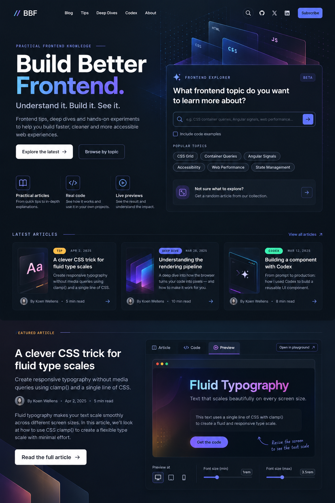

# Build Better Frontend — Design System

Version: 0.1 · Documentation baseline · 12 October 2026

## Status and reference

**Confirmed:** modern technical dark navy design, Plus Jakarta Sans, Fira Code, and the visual direction of the supplied homepage mock-up.

**Proposal:** all exact tokens, sizes, breakpoints, timing values, component states, and implementation details below. They convert the established direction into a consistent, reviewable system; they are not exact measurements extracted from the image.

**Open:** final numerical tuning, logo asset, illustrations, and remaining interface copy. **Later:** additional themes and Playground.

The status definitions and release scope are in [Product](product.md). Content behavior belongs to [Article experience](article-experience.md); technical delivery belongs to [Architecture](architecture.md).

### Visual reference



The original user-supplied image is preserved unchanged at `docs/reference_image.png`. It shows the desktop homepage, not a complete responsive specification or a list of implemented features.

## Design direction

Working description carried forward: **Modern Engineering × Developer Playground**. Here “Playground” describes the exploratory visual character; editable code execution is outside v1.

Personality: precise, technical, creative, and approachable. Use dark navy surfaces, strong typography, fine borders, restrained cyan/blue/violet accents, and selective monospace labels.

The mock-up's distinctive features are:

- A compact wordmark with two colored slashes.
- A large two-line “Build Better Frontend.” headline; “Frontend.” carries the gradient.
- A substantial Explorer panel in the right hero column, over translucent HTML/CSS/JS layers and a dotted technical background.
- White editorial CTA buttons alongside outlined secondary actions.
- Three compact article cards with vertical illustrations on the left.
- A featured section with narrative on the left and an interactive example frame on the right.
- Subtle ambient light and fine dividers, with ample space between major sections.

Avoid pure-black page backgrounds, neon effects on every component, persistent decorative animation, excessive card nesting, and terminal styling for ordinary reading. Keep the Article reading view quieter than the homepage hero.

## Proposed color tokens

### Foundation

| Token | Value | Intended use |
|---|---|---|
| `--color-background` | `#0B1320` | Main page background |
| `--color-surface` | `#111C2D` | Cards, Explorer, code panels |
| `--color-surface-raised` | `#19263A` | Elevated panels and discovery inset |
| `--color-surface-hover` | `#213149` | Hover surfaces |
| `--color-border` | `#2B3A52` | Decorative separators and panel edges |
| `--color-control-border` | `#61738F` | Essential input and control outlines |
| `--color-text` | `#F5F7FC` | Primary text |
| `--color-text-secondary` | `#B3C0D6` | Descriptions and supporting text |
| `--color-text-muted` | `#8393AE` | Metadata, subject to contrast checks |
| `--color-on-accent` | `#0B1320` | Text/icons on bright solid accents |
| `--color-on-light` | `#0B1320` | Text/icons on white editorial CTAs |

The original blueprint's default border is subtle. Do not assume it is sufficient to identify an essential control; the stronger control-border token is an added proposal.

### Brand and category accents

| Token | Value | Intended use |
|---|---|---|
| `--color-primary` | `#5988FF` | Interactive blue accent |
| `--color-secondary` | `#8E72FF` | Violet brand accent |
| `--color-cyan` | `#55CFF5` | Technical illustration details |
| `--color-amber` | `#FFBE4F` | Frontend Tips |
| `--color-violet` | `#8977FF` | Deep Dives |
| `--color-mint` | `#45E4BC` | Building with Codex |
| `--color-focus` | `#55CFF5` | Focus ring |

Category color belongs to badges, small icons, and illustrations. Keep action styles consistent across categories. Render category names in text; color alone never identifies a category.

```css
--gradient-brand: linear-gradient(
  110deg,
  #55cffa 0%,
  #5988ff 45%,
  #8e72ff 100%
);
```

The gradient is carried forward from the earlier draft and differs slightly from the solid cyan token deliberately. Limit it to the hero's “Frontend.” word and small visual accents. Provide a solid-text fallback. Do not apply gradients to paragraphs or essential labels.

All foreground/background combinations, including gradients and transparent surfaces, require contrast verification in their actual context. These values are candidates, not a claim of a compliant rendered interface.

## Proposed typography

| Role | Font | Suggested weights |
|---|---|---|
| Headlines, prose, navigation, buttons | Plus Jakarta Sans | 400, 500, 600, 700, 800 as needed |
| Code and compact technical labels | Fira Code | 400, 500 as needed |

Load only the weights actually used; a suitable variable font may cover the required range. Use system sans-serif and monospace fallbacks. Article prose never uses Fira Code. Enable its ligatures in code where they do not impair the teaching example; preserve the original characters when copying.

| Token | Size | Role |
|---|---|---|
| `--text-xs` | `0.75rem` / 12px | Small metadata |
| `--text-sm` | `0.875rem` / 14px | Labels, secondary UI |
| `--text-base` | `1rem` / 16px | Interface text |
| `--text-lg` | `1.125rem` / 18px | Article prose |
| `--text-xl` | `1.375rem` / 22px | Small headings |
| `--text-2xl` | `1.75rem` / 28px | Section headings |
| `--text-3xl` | `2.25rem` / 36px | Page headings |
| `--text-display` | `clamp(3rem, 5vw, 5rem)` | Hero headline |

Pixel equivalents assume a 16px root; preserve user text sizing. Suggested line heights: prose 1.7, headings 1.1–1.25, code 1.6. Use uppercase letter-spaced monospace for short eyebrows such as “Latest articles,” never long descriptions. Small metadata must remain readable on mobile.

## Proposed layout tokens

| Container | Maximum width |
|---|---|
| Outer site | 1440px |
| Standard content | 1200px |
| Article reading column | 760px, with prose around 65–75 characters per line |
| Wide article examples | 1100px |

Spacing scale: **4 / 8 / 12 / 16 / 24 / 32 / 48 / 64 / 96px**, expressed in relative units where appropriate.

Page gutters: mobile 20px, tablet 32px, desktop 48px. Suggested radii: buttons and inputs 10px; article cards 14px; Explorer 16px; Code / Preview panels 12px; topic chips pill-shaped.

Use subtle shadows and fine borders. Restrict directional glow to large featured surfaces. Background decoration stays behind controls and does not create page overflow.

### Responsive proposal

| Width | Composition |
|---|---|
| Below 40rem | Stacked hero and featured section, one article-card column, compact navigation |
| 40rem–59.99rem | Stacked hero; two article columns only when cards fit comfortably |
| 60rem and above | Two-column hero, roughly 45% / 55%; three article columns; two-column featured section |

Breakpoints respond to content fit rather than named devices. Adjust them if typography, translation of future copy, or text zoom causes collisions. Navigation can collapse before the hero does. Keep DOM reading order consistent across layouts.

At narrow widths, chips wrap, search keeps a full-width input, and source files scroll inside their panels. Avoid horizontal page scrolling. Do not preserve the desktop illustration at the expense of readable content.

## Component specifications — proposals

### Header and wordmark

Keep `// BBF` compact and legible. The wordmark links home with an accessible name identifying the publication. Desktop navigation follows the mock-up: Blog, Tips, Deep Dives, Codex, About. Use the full “Building with Codex” category name in archive headings even when navigation uses “Codex.”

Use a visible active-page indicator and `aria-current` on the relevant link. Icon-only search and social links need accessible names. Mobile navigation uses a labeled button, visible expanded state, and ordinary navigation links. Preserve keyboard access and a clear close action.

Show GitHub and social icons only for real destinations. Omit Subscribe until operational subscriptions are selected. Sticky-header behavior is not confirmed; proposed default is a normal-flow header.

### Hero

Left column: technical eyebrow, large headline, tagline, short mission statement, two CTAs, three feature highlights. Right column: Explorer with a decorative technical composition behind it.

Use the provided headline and tagline as carried-forward copy. Exact supporting copy remains editable. The hero contains the page's single primary heading. Decorative HTML/CSS/JS layers and dots are hidden from assistive technology and never intercept pointer events.

Proposed primary editorial CTA: light background with dark text, matching the mock-up. Secondary CTA: outlined navy surface. Search submission can use the solid blue/violet accent family with a verified foreground color.

### Frontend Explorer

Panel anatomy: eyebrow, optional status badge, heading, labeled search form, code-resource filter, topic chips, random-discovery inset, and a results region after submission.

The submitted state is absent from the image. Proposed results stay within the hero layout as a list below the form; on narrow screens they extend naturally in document flow. Include result count, clear/reset controls, and an archive link when useful. Do not hide the entire Explorer behind a modal or a chat-style response.

Input outline must remain identifiable before focus. Focus, loading, error, selected filters, and empty results each need clear text or state cues. Checkbox selection is independent of search submission. Use native form controls where possible.

The mock-up's “Beta” badge is optional copy, not a required design token. Final search and random-action wording is owned by [Product](product.md).

### Feature highlights and category presentation

Three simple items: Practical articles, Real code, Live previews. Each has a small outlined icon, title, and short description. They describe platform capabilities, not a guarantee that every article has code and a preview.

Separate category cards remain optional. If introduced, use the same category naming and accent mapping rather than a new visual system.

### Article cards

Default homepage card follows the mock-up: vertical thumbnail at the left of the content, badge/date above title, short description, author/reading time below, and a small navigation arrow. Across the desktop row, align dimensions and rhythm without truncating important titles.

Illustrations are optional; a card without an image must remain balanced. Metadata uses real dates and computed reading time. Proposed badges can use short “TIP”, “DEEP DIVE”, and “CODEX” labels, with full category names available in context.

Use a title link or one semantically sound card link. Do not place interactive perspective tabs inside a whole-card link. Resource indicators may advertise code/preview availability without becoming competing nested controls. Decorative thumbnails can have empty alternatives; informative images need descriptive alternatives.

### Featured article experience

Left: featured label, title, description, author/date/reading time, excerpt, full-article CTA. Right: shared Article / Code / Preview navigation and a working example panel.

The illustrated active perspective is Preview. Proposed homepage default may be Preview when the selected real article has one; the canonical article page still starts with Article. Article shows a curated excerpt here, Code shows actual source, and Preview runs the selected example. All use the shared example data.

Do not reproduce “Open in playground” in v1. Browser chrome, viewport buttons, and font-size sliders belong only to suitable demos with implemented behavior. A viewport control changes the demo frame, not the visitor's browser.

### Article page and example panels

Reading view uses the quiet prose column, with wider examples where useful. Provide a title block, metadata, perspective navigation, headings, source links, and a table of contents when article length warrants it.

Source panels show language/file labels, selectable highlighted text, a labeled copy button, and a local horizontal scrollbar when necessary. Preview panels have descriptive titles, loading/error states, and ordinary fallback links. Their behavior is specified in [Article experience](article-experience.md).

### Footer

Proposed addition beyond the supplied image: wordmark, brief mission, archive/About/GitHub links, RSS when available, and accurate copyright information. Keep it quieter than the hero. Do not include unused subscription fields.

## States, motion, and accessibility

Proposed timings: button hover 150ms, card hover 200ms, perspective change 150ms, result transition 200ms. Avoid animating essential layout or autoplaying background effects. Honor reduced-motion preferences by removing decorative motion.

Every interactive component needs default, hover, visible focus, active/selected, and disabled states where relevant. Hover never reveals the only route to essential information. Use a clearly offset focus ring; prevent clipping and obscuring it. Aim for comfortable 44px touch controls where feasible.

**Proposed target carried forward:** [WCAG 2.2 AA](https://www.w3.org/TR/WCAG22/). Verify normal text contrast of at least 4.5:1, large text 3:1, and essential control boundaries/state indicators 3:1 where the criterion applies. Support keyboard navigation, semantic headings, labels, text resizing, reflow, and reduced motion. A visually attractive token table does not establish compliance.

For enhanced tabs, follow the [WAI-ARIA tabs pattern](https://www.w3.org/WAI/ARIA/apg/patterns/tabs/); retain ordinary content and links as the unenhanced baseline. See Article experience for detailed keyboard and URL behavior.

## Visual acceptance proposal and open choices

Review the implemented header, hero balance, gradient headline, Explorer layering, compact article cards, and featured panel against the reference. Also inspect a text-heavy article, articles without previews, empty search, missing images, long titles, mobile layouts, and zoomed text.

Open: final logo format, original illustration assets, syntax theme, exact token tuning, responsive breakpoints, and final interface copy. The reference does not supply production-ready separate images, logos, avatars, or fonts; those assets must be created or sourced with appropriate licenses during implementation.

